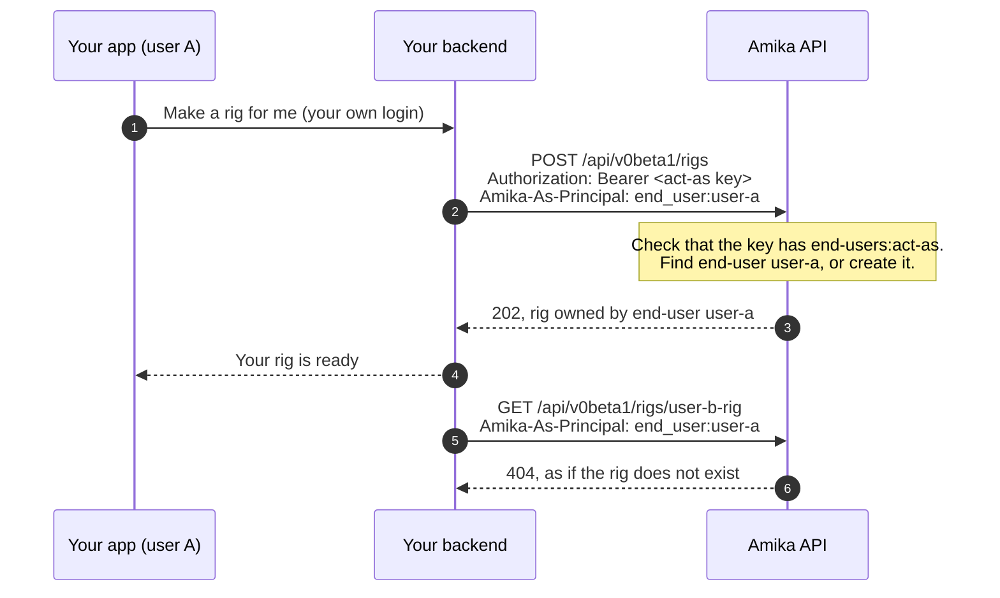
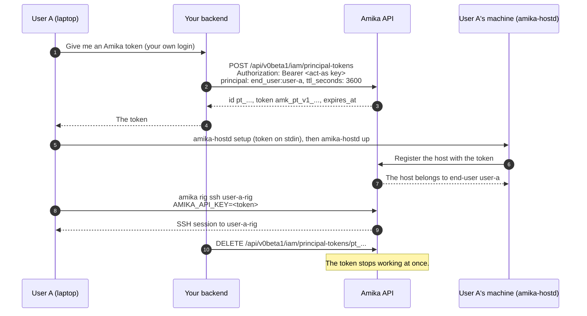

Your backend has one Amika API key with the `end-users:act-as` permission.
This page calls it the **act-as key**. Keep the act-as key on your backend.
Do not send it to your users.

Your backend can use the act-as key in two ways:

| Way             | Who calls Amika                  | What it sends to Amika                             | Use it when                            |
| --------------- | -------------------------------- | -------------------------------------------------- | -------------------------------------- |
| Act-as header   | Your backend                     | The act-as key and the `Amika-As-Principal` header | Your backend does work for an end-user |
| Principal token | The end-user's machine or laptop | A principal token                                  | The end-user does work themselves      |

To set up your backend and create rigs for your users, see
[End-user access](/platform/end-user-access).

## Act as an end-user with the `Amika-As-Principal` header

Your backend sends two things on each HTTP API request:

- The act-as key, in the `Authorization` header.
- The header `Amika-As-Principal: end_user:<your user id>`.

Amika does the request as that end-user. The end-user gets no credential.



In the SDK, `actAs` returns a new client. The new client acts as the
end-user:

```ts
import { AmikaClient } from "@amika/sdk";

const backend = new AmikaClient({ apiKey: process.env.AMIKA_ACT_AS_KEY! });
const userA = backend.actAs("end_user:user-a");
await userA.rigs.create({ name: "user-a-rig" });
```

Rules:

- Without the `Amika-As-Principal` header, the act-as key gets `403` on all
  routes except three: mint a token, revoke a token, and disable an
  end-user.
- The act-as key cannot act as your organization.
- After you disable an end-user, a request that acts as them gets `403`.

## Give the end-user a principal token

Your backend mints a **principal token** for one end-user. The end-user's
machine and laptop send this token to Amika. The act-as key stays on your
backend.



In the SDK:

```ts
const { id, token, expiresAt } = await backend.principalTokens.mint({
  principal: "end_user:user-a",
  ttlSeconds: 3600, // The default is 3600. The maximum is 86400 (24 hours).
});
await backend.principalTokens.revoke(id); // Revoke the token when you no longer need it.
```

Rules:

- A principal token acts as one end-user. It cannot mint a token.
- A principal token expires after its TTL. The maximum TTL is 24 hours. Mint
  a new token before the old one expires. In an app, `refreshingTokenSource`
  in the SDK does this for you.
- When you disable an end-user, all of their tokens stop working at once.
